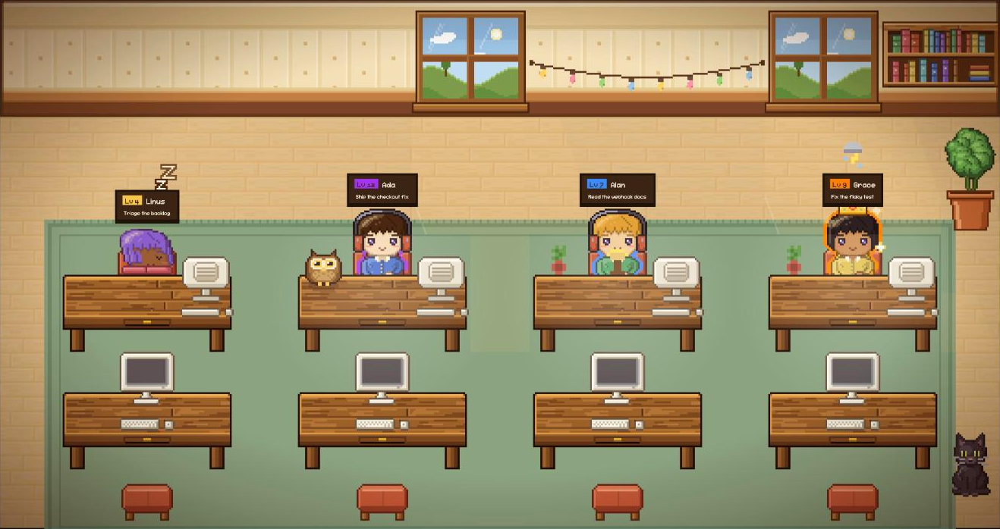

<h1 align="center">Pixel Agents, cozy fork</h1>

<p align="center">
  
</p>

Your Claude Code sessions as a pixel office. Each session is a character at a desk: it types while the agent works, reads or naps while it waits for you, and levels up as it ships.

This is a fork of [pixel-agents](https://github.com/pixel-agents-hq/pixel-agents) by Pablo De Lucca (MIT). The engine, hooks and layout editor come from upstream. The differences are below.

## What this fork changes

**Art.** Every sprite is drawn by code in `scripts/cozy-art` at 2x density: 12 characters, 41 furniture sprites, floors, walls, rugs, pets. No paid asset pack. `npm run cozy:assets` regenerates them byte for byte.

**A crew that remembers.** Sessions claim a member from `~/.pixel-agents/roster.json` and keep its name, look and XP across restarts. XP per turn: tool turn +50, clean turn +25 (plus a streak bonus up to 50), text-only turn +10, finished sub-agent +15, a commit or PR +100. Level N to N+1 costs `round(100 * N^1.5)`.

**Idle looks idle.** Status comes from the tail of the transcript, so a session that finished an hour ago does not sit there typing. Waiting agents read a book, nap after 10 minutes, or walk to the lounge for coffee. Sub-agents show up as gray helpers next to their parent.

**Rooms per project.** Map workspace folders to Areas and each project gets its own room. The camera frames the rooms where someone is working.

**Model at a glance.** Haiku, Sonnet, Opus and Fable each get a badge color, an accessory and a desk companion (bird, cat, owl, dragon).

**Token usage.** The Usage panel ranks rooms and sessions by tokens in the current 5-hour block and the week, weighted by cost. Budgets are optional.

**Tripwires.** 14 rules flag risky tool calls with an alarm on the agent: credential and key reads, `curl | sh`, force pushes, `rm -rf ~`, cloud and cluster writes, tampering with the hooks. Matched text never leaves the local server. See [docs/tripwires.md](docs/tripwires.md).

**Day and night.** Light follows your clock: window light in the morning, a darker room at night lit by the lamp, the active monitors and the fairy lights.

**Security fixes over upstream.** The standalone WebSocket requires the session token. On a loopback bind the server refuses any `Host` that is not `127.0.0.1`, `localhost` or `::1`, which blocks DNS rebinding. Bash activity shows the program name, not the full command line.

## Run it

Requirements: Node.js 20+, [Claude Code](https://docs.anthropic.com/en/docs/claude-code).

```bash
git clone https://github.com/gustavoortega/pixel-agents.git
cd pixel-agents
npm install
npm run build
node dist/cli.js --host 127.0.0.1
```

Open the URL it prints. It carries a `?token=` that gives full control of the office, including installing the Claude Code hooks, so treat it as a password. The first run asks before it touches `~/.claude/settings.json`.

Keep the default bind. `--host 0.0.0.0` puts the office and its token-gated socket on your network.

`npx pixel-agents` and the VS Code Marketplace install upstream, not this fork. For VS Code, open the repo and press F5.

### Layout

A fresh install opens the cozy office (Studio, Lab, Den, a lounge and a cat). If you already have `~/.pixel-agents/layout.json`, it is kept. To switch to the new office, back it up and delete it:

```bash
mv ~/.pixel-agents/layout.json ~/.pixel-agents/layout.json.bak
```

Click **Layout** to edit rooms, furniture, rugs and Areas.

## Development

```bash
npm run check-types
npm run lint
npm test
```

The hero image comes from a staged scene in the dev server:

```bash
cd webview-ui && npx vite --host 127.0.0.1 --port 5199
# open http://127.0.0.1:5199/?scene=hero&hud=0
```

[CLAUDE.md](CLAUDE.md) documents the architecture, [docs/cozy-art.md](docs/cozy-art.md) the art generator.

## License

MIT, same as upstream. See [LICENSE](LICENSE).
